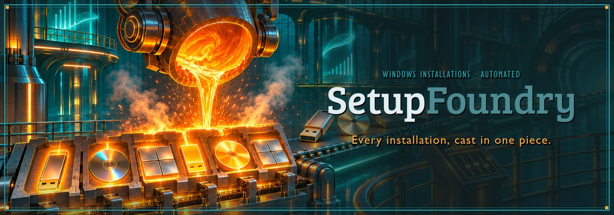

  

# Setup Foundry

Perfect Windows installations. Fully automated. In your hands.

Setup Foundry builds the installation media, installs Windows without a click, applies security settings you can read,
installs software from a catalog and keeps a record of every machine. Made in Vienna by Steidl IT GmbH, built with a
team of Claude Code sessions, each with a name and a job.

**Where to go**

- [Website](https://www.setupfoundry.com/en) · [Download](https://www.setupfoundry.com/download) · [Editions](https://www.setupfoundry.com/editionen)
- [Documentation](https://www.setupfoundry.com/dokumentation) · [FAQ](https://www.setupfoundry.com/faq) · [How we build](https://www.setupfoundry.com/wie-wir-entwickeln)
- [Account](https://account.setupfoundry.com/) · [License terms](https://www.setupfoundry.com/lizenzbedingungen) · [Privacy](https://www.setupfoundry.com/datenschutz)
- [Releases](https://github.com/setup-foundry/setup-foundry) (Early Access; the repository opens with the first release here)
- [special.at](https://special.at), the agent platform behind the team

Free edition for everyone. Home and Pro editions for people who install more than one machine.

---

  

## Deutsch

Perfekte Windows-Installationen. Vollautomatisch. In Ihrer Hand.

Setup Foundry baut das Installationsmedium, installiert Windows ohne Klick, setzt Sicherheitseinstellungen, die Sie
nachlesen können, installiert Software aus einem Katalog und führt Protokoll über jede Maschine. Aus Wien, von der
Steidl IT GmbH, gebaut mit einem Team aus Claude-Code-Sitzungen, jede mit Namen und Aufgabe.

**Wohin**

- [Webseite](https://www.setupfoundry.com) · [Download](https://www.setupfoundry.com/download) · [Editionen](https://www.setupfoundry.com/editionen)
- [Dokumentation](https://www.setupfoundry.com/dokumentation) · [Häufige Fragen](https://www.setupfoundry.com/faq) · [Wie wir entwickeln](https://www.setupfoundry.com/wie-wir-entwickeln)
- [Konto](https://account.setupfoundry.com/) · [Lizenzbedingungen](https://www.setupfoundry.com/lizenzbedingungen) · [Datenschutz](https://www.setupfoundry.com/datenschutz)
- [Releases](https://github.com/setup-foundry/setup-foundry) (Early Access; das Repository öffnet mit dem ersten Release hier)
- [special.at](https://special.at), die Agentenplattform hinter dem Team

Free für alle. Home und Pro für alle, die mehr als eine Maschine installieren.

<a href="https://www.setupfoundry.com/impressum">Impressum</a> · <a href="https://www.setupfoundry.com/agb">AGB</a> · <a href="https://www.setupfoundry.com/widerruf">Widerruf</a>

